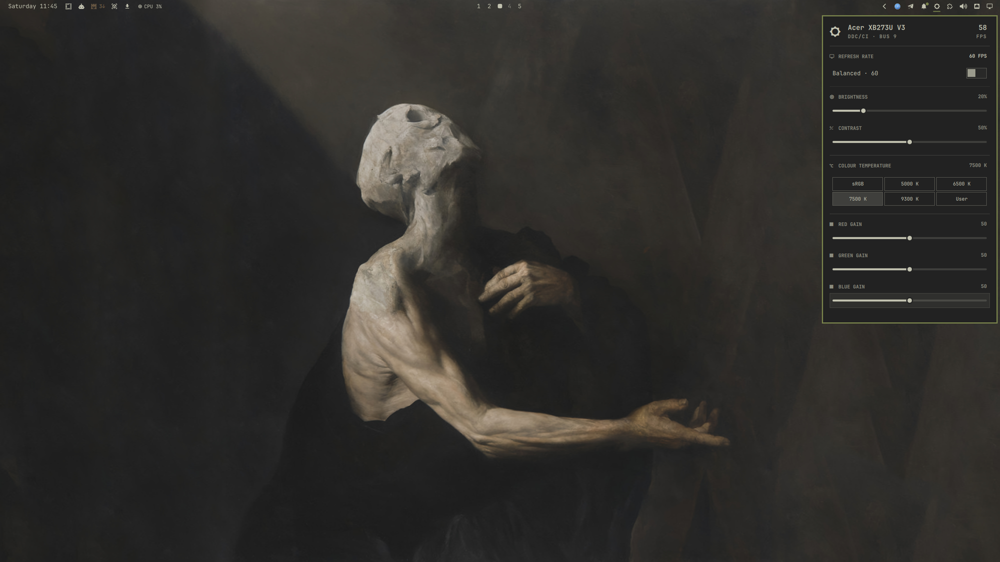

# Acer Predator XB273U V3 (27-inch WQHD) for Omarchy



An Omarchy bar widget that controls an Acer Nitro XB273U V3 over DDC/CI. Click the sun icon in the bar to open its popup. Scrolling on the icon changes brightness.

- **Refresh rate toggle**: flip between a balanced rate (60 FPS by default) and a high-performance rate (the monitor's maximum, 180 FPS on the XB273U V3). The popup also shows the current rate.
- **Brightness**, 0 to 100.
- **Contrast**, 0 to 100.
- **Colour temperature preset**: sRGB, 5000 K, 6500 K, 7500 K, 9300 K or User.
- **RGB gain**, 0 to 100 per channel.

It deliberately covers only a few everyday settings.

## Requirements

- Omarchy 4, which includes `ddcutil`.
- DDC/CI turned on in the monitor's on-screen menu.

If `ddcutil detect` lists your monitor, you are set. If the command is missing, run `omarchy pkg add ddcutil`.

## Install

```sh
omarchy plugin add https://github.com/cjbricklz/omarchy-acer-xb273u-v3 --enable
```

To update it to the latest version:

```sh
omarchy plugin update puck.acer-xb273u-v3
```

To remove it:

```sh
omarchy plugin remove puck.acer-xb273u-v3
```

## Pick the monitor

The plugin finds the XB273U V3 by itself. Without one, it uses the first Acer monitor it finds. To use a specific I2C bus, add `bus` to the widget's entry in `~/.config/omarchy/shell.json`:

```json
{ "id": "puck.acer-xb273u-v3", "bus": "9" }
```

`ddcutil detect --brief` shows the bus number in the `I2C bus: /dev/i2c-N` line.

## Refresh rate

The toggle changes the monitor's refresh rate through Hyprland, so "FPS" here is the display's refresh rate, the most frames it can show per second. It is not a per-game frame counter.

The change is runtime only. It does not edit `~/.config/hypr/monitors.lua`, so reloading Hyprland or logging out returns the monitor to its configured rate. Position, scale and rotation are kept.

Both rates are picked from what the monitor offers at its current resolution, using the closest match. To change them, add settings to the widget's entry in `~/.config/omarchy/shell.json`:

```json
{ "id": "puck.acer-xb273u-v3", "balancedHz": 120, "performanceHz": 165 }
```

`balancedHz` defaults to 60. `performanceHz` defaults to 0, which means the highest available rate. If the Hyprland output name cannot be detected, set `"output": "DP-3"` as well.

## Notes on the monitor

- The monitor answers individual `getvcp`/`setvcp` calls, but `ddcutil capabilities` fails with "Maximum DDC retries exceeded". The plugin does not need it.
- The preset values are the standard MCCS codes (`0x01` sRGB, `0x04` 5000 K, `0x05` 6500 K, `0x06` 7500 K, `0x08` 9300 K, `0x0b` User). Only 7500 K was read back from the monitor; if a button does nothing on your unit, that value is not supported.
- The RGB gain probably only takes effect in the User preset. Acer's own display modes (`0xdc`) are not exposed because their values are unconfirmed.

## Tests

```sh
node tests/model.test.js
```

## License

MIT. See [LICENSE](LICENSE).
